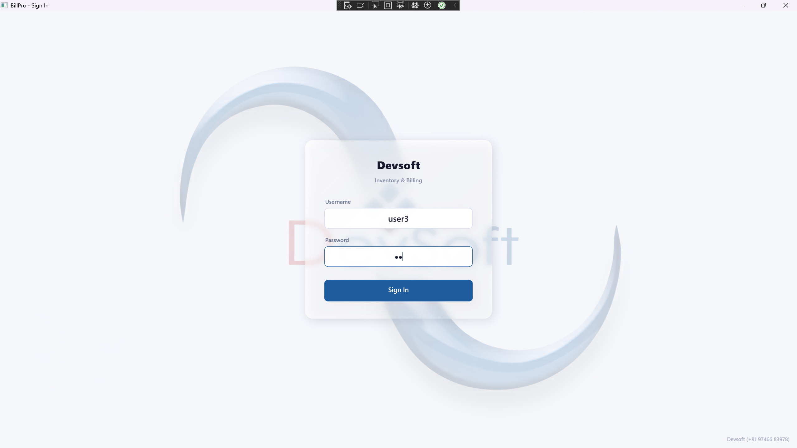
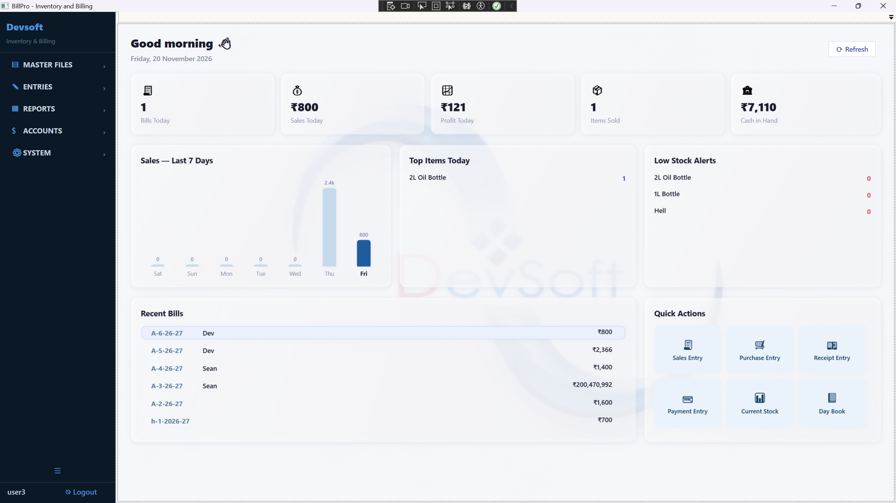
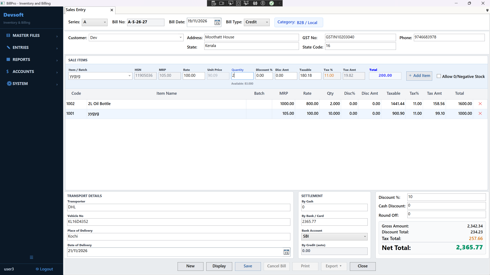
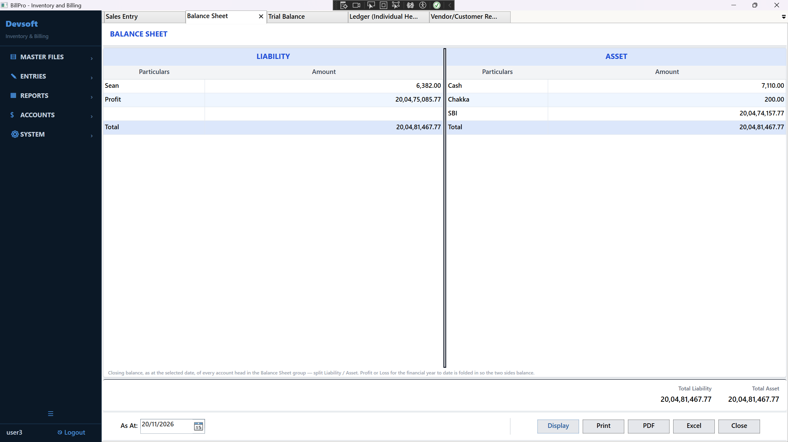
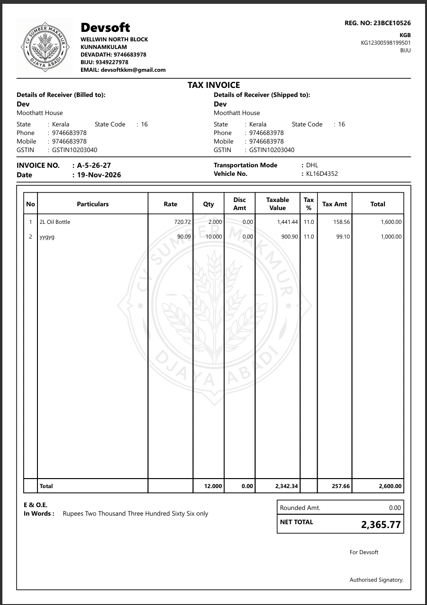
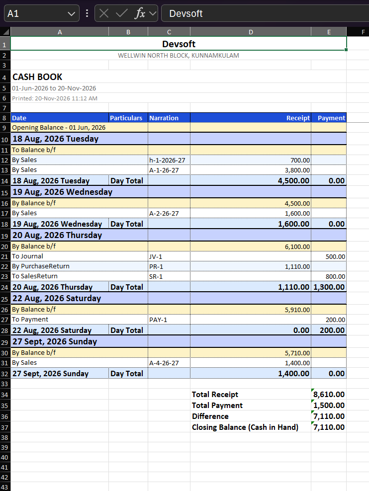

# BillPro

**GST billing, inventory and accounting desktop application for Indian businesses.**

BillPro is a Windows desktop app built with WPF and .NET 8. It covers the full cycle of a small trading or manufacturing business: item and party masters, sales and purchase billing with GST, returns, batch-level stock tracking, and double-entry accounts with the standard financial reports.

> **Status:** test/portfolio version. The production version is developed separately.

## Screenshots

| | |
|---|---|
| **Login**<br> | **Dashboard**<br> |
| **Sales entry**<br> | **Balance sheet**<br> |
| **Invoice PDF**<br> | **Cash Book Excel**<br> |


## Features

**Billing and inventory**
- Sales and purchase entry with tax-inclusive rates, cash and credit modes, and a settlement panel (cash / bank / credit)
- Sales return and purchase return entry with their own bill numbering (SR-n / PR-n)
- Configurable sales series (prefix/suffix, running numbers)
- Batch-level stock with opening stock, short/excess stock adjustments and production entry with product formulas
- Item, HSN code, UQC, vendor/customer and vehicle masters

**Accounts and reports**
- Receipt, Payment and Journal vouchers
- Ledger, Daybook, Cash Book, Trial Balance, Trading and Profit & Loss, Balance Sheet
- Sundry Debtors and Creditors, current and individual stock reports
- Itemwise, settlement and return reports for sales and purchases
- Every report exports to **Print, PDF and Excel**

**Application**
- GST invoice generation as PDF and Excel
- Role-based access control with four permission tiers and a customizable menu
- Tabbed multi-document interface with a collapsible animated sidebar
- Dashboard and password-protected company details

## Tech stack

| Area | Technology |
|---|---|
| Language / runtime | C#, .NET 8 |
| UI | WPF, Syncfusion WPF controls (SfDataGrid), AvalonDock |
| Data | SQLite with Dapper |
| PDF / Excel | QuestPDF, PdfSharp, ClosedXML |

## Architecture highlights

- **Master + Batch + Ledger inventory model.** `item_master` holds identity only, `item_batch_details` holds pricing tiers, and `stock_transaction_details` is a ledger (opening, purchase, sale, returns) with quantity in/out. Current stock is computed from a view rather than stored, so it can't drift out of sync.
- **Separate accounts database.** Inventory data and accounting data live in separate SQLite databases (`inventory.db`, `accounts.db`).
- **Financial sync service.** Bills post to the accounts side through a `FinancialSyncService` that writes daily consolidated postings, keeps a per-voucher tax audit trail, and flags failed syncs for a later re-sync instead of blocking billing.
- **Transaction-wrapped saves.** Multi-table writes run inside a single database transaction, and edits reverse earlier postings before reposting.
- **Repository pattern with self-healing schema.** Repositories use Dapper, and missing columns are added at startup so older databases upgrade without manual migration.
- **Reusable entry-view pattern.** Sales, purchase and return screens share one structure: header panel, item entry line above a grid, re-entrancy guards for calculation, and observable collections that drive totals.
- **Shared report infrastructure.** One set of column definitions drives on-screen grids, printing, PDF and Excel output.
- **Role-based access.** Permission checks go through a central gate, with salted SHA-256 password hashing.

## Project structure

```
BillPro.sln
BillPro/
├── Controls/        Custom controls (SmartComboBox, filter controls, nav flyout)
├── DataAccess/      Database bootstrapper and reserved default data
├── Helpers/         Print, PDF and Excel helpers, permission gate, behaviors
├── Models/          Entity and report models
├── Repositories/    Dapper repositories and accounting sync services
├── Resources/       Global styles and assets
└── Views/           WPF windows and views
```

## Getting started

**Requirements**
- Windows 10/11
- [.NET 8 SDK](https://dotnet.microsoft.com/download/dotnet/8.0)
- Visual Studio 2022 (17.8+) or later with the ".NET desktop development" workload
- A free [Syncfusion Community License](https://www.syncfusion.com/products/communitylicense) key

**Setup**

1. Clone the repository:
   ```bash
   git clone https://github.com/<your-username>/BillPro.git
   cd BillPro
   ```
2. Create `BillPro/secrets.local.json` (this file is git-ignored) using `secrets.example.json` as a template:
   ```json
   {
     "SyncfusionLicenseKey": "YOUR-LICENSE-KEY"
   }
   ```
3. Open `BillPro.sln`, set the platform to **x64**, and press F5. You can also build from the command line:
   ```bash
   dotnet build BillPro.sln -p:Platform=x64
   ```
4. The databases are created on first run. Sign in with the demo credentials below.

**Demo login:** `user3` / `u3`

## Notes

- The SQLite databases are excluded from the repository, so the app starts with empty data.
- The project targets x64 only (Debug and Release).

## Author

**Devadath MB** · [GitHub](https://github.com/<your-username>)
